# Actually Smart Contracts

Live site: [asc.verafy.ai](https://asc.verafy.ai)

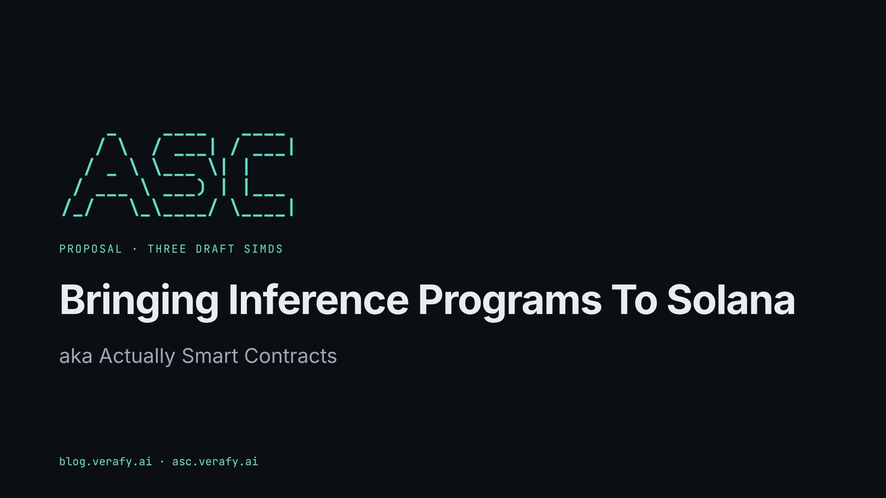

Actually Smart Contracts (ASC) is a Verafy research prototype, and the informal
name for **inference programs** on Solana: programs written in natural language,
stored on chain, run by AI models off chain, and answered with a signed ruling
that any Solana program can check and act on. A ruling can be a judgment, a
policy check or a prediction.

This repository holds the site and three draft Solana Improvement Documents
(SIMDs) that would make inference programs a shared standard, so every program,
wallet and explorer can use them the same way. The drafts are for discussion in
the [SIMD Ideas](https://github.com/solana-foundation/solana-improvement-documents/discussions/categories/ideas)
forum and are not yet submitted.

It settles on Solana. No coin, no token, play money only.

## Why

A smart contract can enforce only what code can express: balances, signatures,
timestamps and arithmetic. Many rules that matter most are judgments. A DAO can
pass a constitution but has no one to enforce it. An insurer can write a policy,
but deciding whether a claim qualifies still happens off chain, by people. An
exchange can only wrap its hot wallets in procedures that code can express.
Inference programs let a program get a second opinion, ask an expert panel, or
go to a judiciary for a ruling before it moves funds.


## The three SIMDs

The drafts are in [`simds/`](simds/). Each is numbered `SIMD-XXXX` until it has
a pull-request number; "SIMD 1, 2, 3" only orders the three.

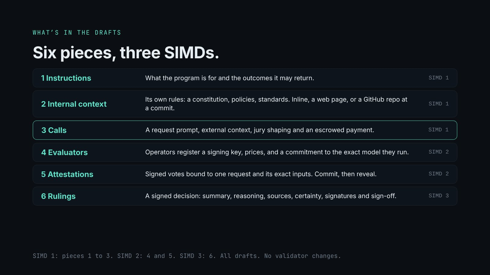

1. **[Inference Programs](simds/inference-programs.md)** (SIMD 1). An inference
   program is an on-chain account that names a prompt (the instructions and the
   outcomes it may return, with a safe default), a context set (its internal
   context: a constitution, a policy, standards, contract terms), an output
   schema and evaluation requirements. Context is stored inline, snapshotted
   from a web page, or pinned from a git repository at a commit, and can be
   compacted, compressed or encrypted to the evaluator set. The creator picks
   whether it is mutable, timelocked or frozen. The SIMD also defines how a
   caller asks for a ruling: `QuoteRuling`, then `RequestRuling` with a request
   prompt, external context, jury shaping and an escrowed budget that pays the
   evaluators and refunds the rest.
2. **[Inference Evaluators and Attestations](simds/inference-attestations.md)**
   (SIMD 2). Evaluators are off-chain model operators. Each registers an Ed25519
   signing key, its prices and a model commitment (which model it runs). For
   each request it commits to an answer, then reveals a signed attestation bound
   to the request, the pinned prompt and context hashes, the input, its outcome
   and confidence. Proofs of inference are far too large to store or verify on
   chain, so the chain stores commitments, availability references and bonds,
   and anyone can challenge a vote. Assurance levels run from L0 (signatures) to
   L2 (proven), with L3 (verified on chain) reserved. It also covers fast
   System 1 evaluators as an informative section.
3. **[Inference Rulings, Disputes and Challenges](simds/inference-rulings.md)**
   (SIMD 3). The ruling is the signed decision recorded when evaluators reach
   quorum. Like a court opinion it records the outcome, a summary, the reasoning
   by hash, the sources relied on (each checked against what the jury was
   given), certainty, every vote's signature, a co-signed sign-off and any
   dissents. Programs read it with `ReadRuling`. A ruling can be disputed
   quickly, or challenged at any later time with new evidence, and marked
   affirmed, overturned or superseded. It is never erased. It also covers
   forecasts and prediction-market resolutions.

Read them rendered on [asc.verafy.ai/simds](https://asc.verafy.ai/simds), with a
table of contents and a Markdown download for each.

## How the lifecycle works

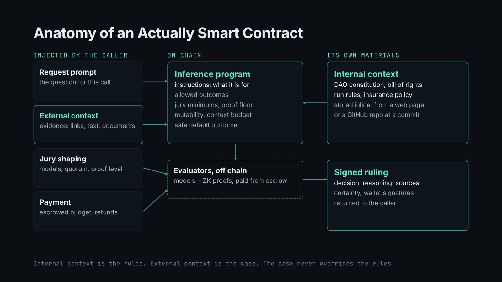

1. **Create.** The creator writes the instructions, lists the outcomes with a
   safe default, attaches internal context, and picks a mutability mode. Every
   request pins the exact hashes it used, so a later edit never changes a past
   ruling. (SIMD 1: `CreateContent`, `SnapshotLink`, `CreateContextSet`,
   `CreateInferenceProgram`, `SetMutability`.)
2. **Call.** Another program, by cross-program invocation, or a user calls
   `RequestRuling` with a request prompt, external context (the case, which
   never overrides the internal context), jury shaping (evaluators, quorum,
   assurance level, allowed model families and models) and payment. A request
   can narrow the program's jury, never widen it.

   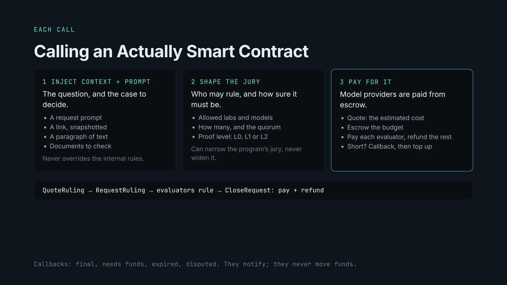

   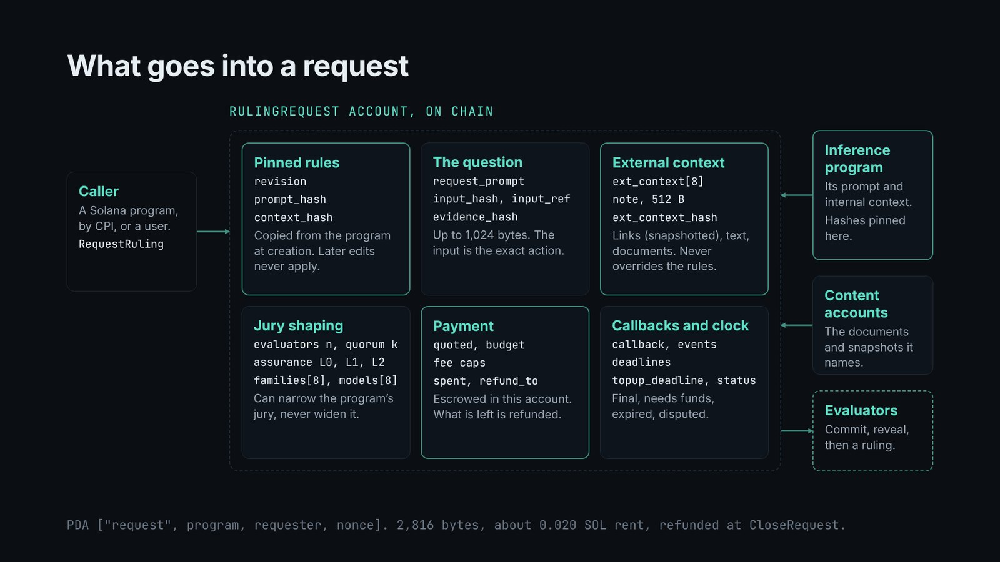

3. **Evaluate.** Evaluators build the model's context in a fixed order
   (instructions, internal context, external context labeled as supplied by the
   caller, then the input), commit to a hash of their answer, then reveal a
   signed attestation. No one can copy the majority.

   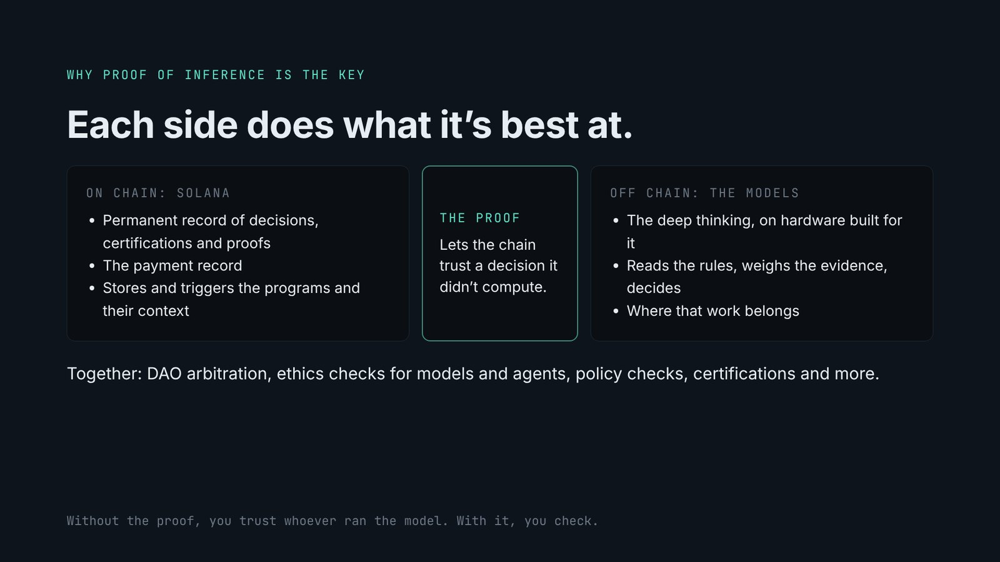

   One proof of inference today is about 18.78 MB against 1,232 bytes per
   Solana transaction, so proofs stay off chain. What goes on chain is a
   commitment by hash, a guarantee that the proof stays downloadable, a bond,
   and the right for anyone to challenge. A stored proof hash proves nothing on
   its own.

   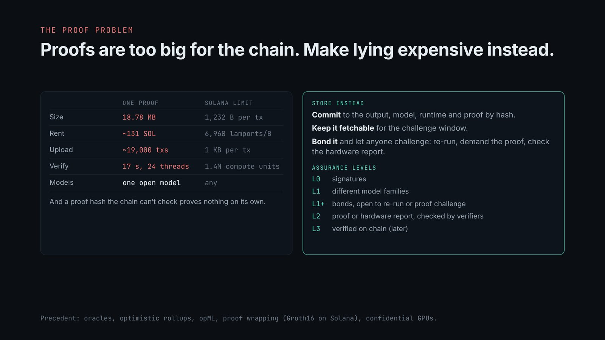

4. **Rule.** When a quorum agrees, one agreeing evaluator (the rapporteur)
   writes the opinion: a short summary on chain, the full reasoning by hash, and
   the sources relied on. The others co-sign. Dissents are recorded.

   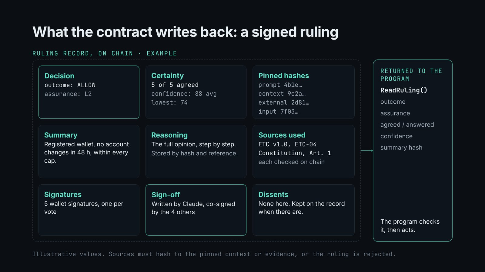

   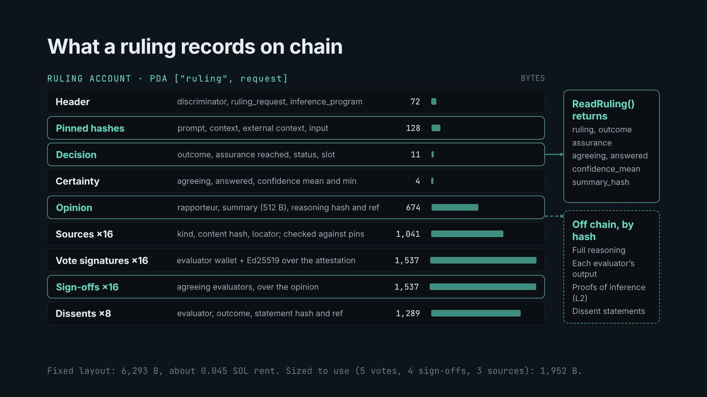

5. **Act.** Rulings take seconds to minutes, so every guarded action is
   two-phase: request a ruling with the exact action as input, then perform the
   action only if `read_ruling` finds a final ruling for that exact input, under
   the prompt and context hashes the program trusts. Hard limits stay in the
   program's own code.
6. **Challenge.** A dispute is quick and re-judges the same evidence with
   different model families. A challenge can come at any time, on new evidence,
   false evidence, misapplied rules or changed rules. A bond, a requirement to
   bring something new, and fresh model families each time stop a losing side
   from relitigating until it wins.

   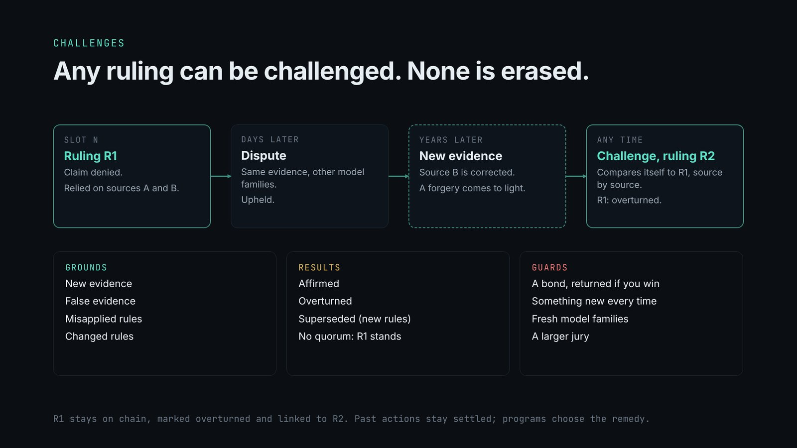

**Predictions.** A forecast request before an event records what independent
models expected; a resolution request after it, from a separate resolver that
never sees the forecast, records what happened.

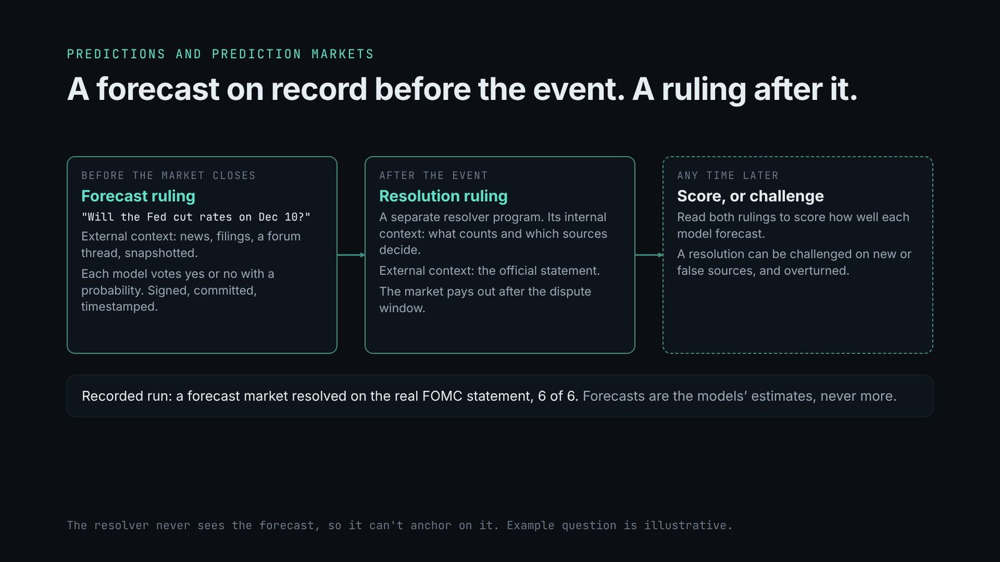

**Fast lane.** System 1 models such as TypeSafe's Jev return a typed answer
with a calibrated probability, and can screen a case before the full jury. Every
Jev figure on the site is vendor-reported and not independently reproduced.

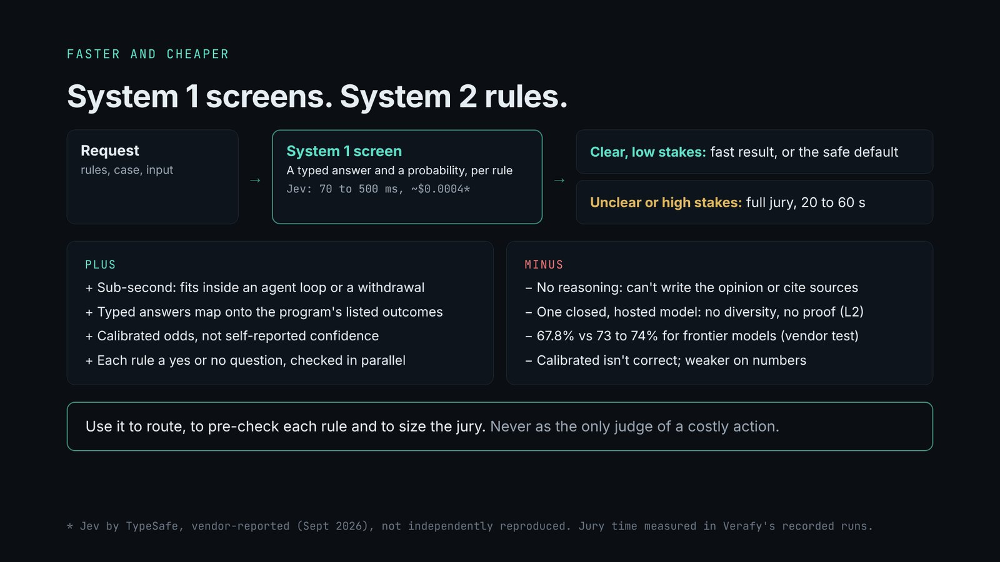

**Limits.** The drafts don't change the validator, don't verify proofs of
inference on chain, and don't make models infallible. In our tests a forged
correction in the evidence fooled all ten models we tried.

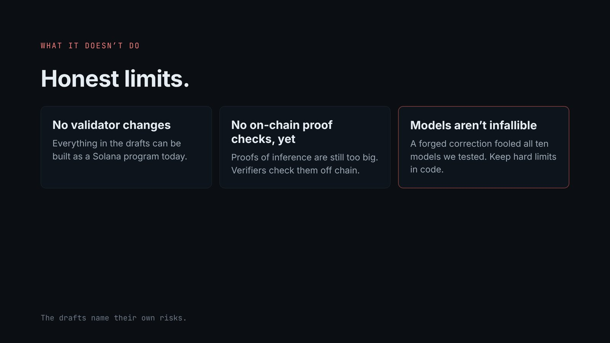

## The site

| Page | What it shows |
|---|---|
| [Home](https://asc.verafy.ai/) | The preamble, the 19-slide deck with its script, and the three drafts |
| [How it works](https://asc.verafy.ai/how-it-works) | The lifecycle step by step, each step citing its SIMD and instructions |
| [Sandbox](https://asc.verafy.ai/sandbox) | Build a program, compose a call, run a simulated jury, read and challenge the ruling |
| [Read the SIMDs](https://asc.verafy.ai/simds) | The three drafts, rendered from `simds/` |
| [Standards](https://asc.verafy.ai/standards) | Five draft standards, held as internal context of kind `standard` |
| [Certifications](https://asc.verafy.ai/certifications) | A certification is a ruling: a repository commit against a standard |
| [Performance](https://asc.verafy.ai/performance) | What a ruling costs and how long it takes, with and without Jev |
| [Security](https://asc.verafy.ai/security) | Assurance levels, the threat model, and trust and limits |
| [ASC run](https://asc.verafy.ai/inscribed) | The hot-wallet run inscribed on a local validator |
| [Recorded runs](https://asc.verafy.ai/runs) | Recorded runs with real model calls, and the local settlement |

The sandbox uses real SHA-256 hashes and real Ed25519 signatures over the SIMD
attestation message, from demo keys (tweetnacl 1.0.3 from cdnjs). Its verdicts
are scripted: no model is called and nothing goes on chain. The hot-wallet
verdicts on the ASC run page were scripted; the other recorded runs used real
model calls.

Every number on the site carries one of these labels: `real`, `modeled`,
`vendor-reported`, `illustrative`, `example data`, `design only`, `draft`.

Old URLs redirect with a 301: `/docs` and `/docs/*` go to `/simds`,
`/docs/trust` to `/security`, `/docs/recorded-runs/:slug` to `/runs/:slug`,
`/code` and `/proposal` to `/simds`, `/certify` to `/certifications`, and
`/demos` to `/`. The full list is in `next.config.ts`.

## Writing about ASC

- [Bringing Inference Programs To Solana](https://blog.verafy.ai/articles/20261105-simd-verifiable-inference)
  (November 5, 2026). The overview of the three draft SIMDs: prompts stored on
  chain, run by models off chain, signed rulings, proofs of which model did the
  work, and challenges, with all three drafts embedded.
- [Actually Smart Contracts: rules in English, enforced by an AI jury](https://blog.verafy.ai/articles/20261104-actually-smart-contracts)
  (November 4, 2026). The prototype that came first: rules in plain English,
  inscribed on Solana and enforced by a signed jury of models from different
  labs.

## Samples

[`simds/samples/`](simds/samples/) holds ten samples written to the SIMD
structure: exchange withdrawals, a DAO constitution, DAO grant milestones, agent
spending, agent customer data, model output audits, treasury rebalancing,
vesting release, certification in CI, and a prediction market. Each has its
prompt (`program.asc.md`), internal context (`context/`), the
`CreateInferenceProgram` arguments (`program.json`) and the calling code. They
are illustrative until an SDK and a reference program exist. See
[simds/samples/README.md](simds/samples/README.md).

## Repository map

| Path | What it is |
|---|---|
| `app/` | Next.js App Router pages and route handlers. One folder per route. |
| `app/api/`, `app/v1/` | API routes kept from v1: quotes, runs, compile, judge, certify |
| `components/Header.tsx`, `Footer.tsx` | The one nav and footer, rendered by `app/layout.tsx` on every page |
| `components/scripts/` | Client scripts for the deck, the SIMD navigation, certifications, the calculator and the sandbox loader |
| `components/oracle/`, `RecordedRun.tsx`, `Chrome.tsx` | The recorded-run and ASC run pages, which keep their v1 styles |
| `lib/simds.ts` | Reads and renders `simds/*.md` at build time |
| `lib/nav.ts` | Nav order and the active-item rule |
| `simds/` | The three draft SIMDs and the ten samples |
| `styles/` | `site.css` (the v2 pages) and `chrome.css` (header and footer) |
| `public/sandbox/sandbox.js` | The sandbox, served as is |
| `public/slides/` | The deck: 18 slide images and `slides.json` with the script |
| `public/simd-flow.svg` | The flow animation on slide 3 and How it works |
| `data/` | Recorded runs, the pilot, settlement data and `performance-model.json` |
| `asc-standards/` | The draft standards (EDO, EAO, ETC, EVC, EMO, ASC-0) |
| `tests/` | Vitest: copy rules, nav, redirects, SIMD anchors, recorded-run verification |
| `scripts/`, `devnet/` | Recording scripts and local-validator settlement scripts |

## Run locally

Needs Node 20 or later.

```
npm ci
npm run typecheck
npm test
npm run build
npm start          # production build on localhost:3000
npm run dev        # development server
```

Re-recording demos spends money and is off by default. Live mode needs
`SWARM_LIVE=1` and `OPENROUTER_API_KEY` on the server. Never commit secrets:
this repository is public.

The localnet scripts need a `solana-test-validator` with the IQ program cloned:

```
cd devnet && npm i && node settle-localnet.mjs
```

## Deploys

The Vercel project `asc` is linked to this repository. `main` is production:
every push to `main` deploys asc.verafy.ai. Work happens on branches, and every
pull request gets a Vercel preview deployment with its own URL. Merge to `main`
only when the preview has been reviewed.
